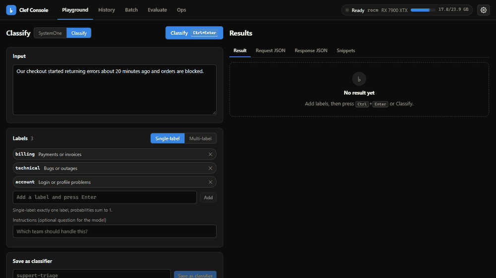
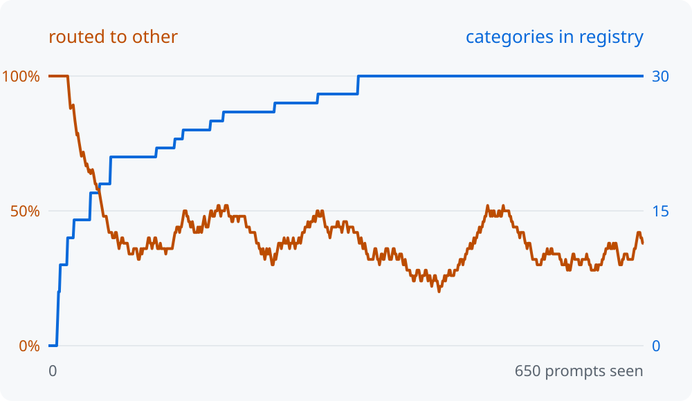
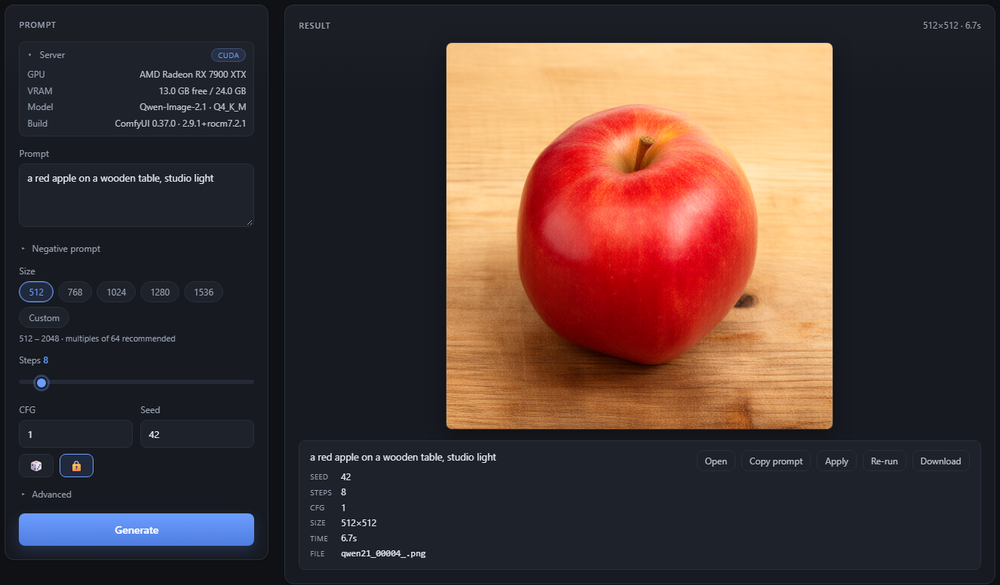

<picture>
  <source media="(prefers-color-scheme: dark)" srcset="assets/header-dark.svg">
  
</picture>

I build systems around small decision models: models that read a prompt and a list of options and return a probability for each option in one forward pass, instead of generating text. They're cheap enough to run on every request, so I use them for routing, triage and classification. That only works if the probabilities are honest, so I measure calibration as well as accuracy.

[LinkedIn](https://www.linkedin.com/in/miguelcarrascobn)

### clef

A self-hosted server for Cloudflare's 9B multimodal decision model, with an OpenAI-compatible API, a web console, async jobs and an evaluation suite that reports ECE and Brier next to accuracy. It fits on 8 to 16 GB GPUs through CPU layer streaming and int8, and I measured what each of those modes costs.

**149 ms** p50 per record · **8.9 req/s** at concurrency 16 · RX 7900 XTX · [docs](https://miguelcarrascob.github.io/clef/)

### More projects

<table>
<tr>
<td width="50%" valign="top">
<a href="https://github.com/MiguelCarrascoB/laya-self-evolving-router"><picture>
  <source media="(prefers-color-scheme: dark)" srcset="assets/router-growth-dark.svg">
  
</picture></a>
 
<b><a href="https://github.com/MiguelCarrascoB/laya-self-evolving-router">laya-self-evolving-router</a></b>
 
An intent router that starts with no categories and grows its own. Laya routes each prompt on-device in about 30 ms, and an LLM is only called to name a new category. Includes a 39-run ablation.
</td>
<td width="50%" valign="top">

 
<b><a href="https://github.com/MiguelCarrascoB/qwen-image-2.1-playground">qwen-image-2.1-playground</a></b>
 
Local text-to-image and image editing with Qwen-Image-2.1 on Apple Silicon and AMD GPUs. A plain JavaScript UI over ComfyUI, no build step.
</td>
</tr>
</table>

**[laya-router](https://github.com/MiguelCarrascoB/laya-router)** is a FastAPI service that picks the cheapest model that can handle a prompt and checks it for prompt injection first. The next step there is calibrating its confidence gate on labelled data.

### Working on now

Training my own decision model with [Unsloth](https://unsloth.ai/docs/basics/train-your-own-decision-model-with-unsloth): a LoRA fine-tune with a classifier head, evaluated on the public typed-decisions benchmark.

- [ ] Fine-tune and record the exact config
- [ ] Before/after table with accuracy, ECE and Brier
- [ ] Model card on Hugging Face
- [ ] Serve it from clef

### Log

- **2026-10** · Started the Unsloth decision model
- **2026-10** · clef: low-memory modes, calibration evals, docs site
- **2026-09** · laya-self-evolving-router: 39-run ablation
- **2026-09** · qwen-image-2.1-playground and laya-router

Python · PyTorch · Transformers · FastAPI · ROCm · MLX · Docker

En español

 

Construyo sistemas con modelos de decisión pequeños: modelos que reciben un prompt y una lista de opciones y devuelven una probabilidad para cada una en una sola pasada, en vez de generar texto. Son lo bastante baratos para ejecutarlos en cada petición, así que los uso para enrutar, priorizar y clasificar. Eso solo funciona si las probabilidades son fiables, así que mido la calibración además de la precisión.

- **clef**: servidor propio para el modelo de decisión de 9B de Cloudflare, con API compatible con OpenAI, consola web y evaluación con ECE y Brier. Funciona en GPUs de 8 a 16 GB.
- **laya-self-evolving-router**: un router que empieza sin categorías y crea las suyas a medida que llegan prompts, con un estudio de ablación de 39 ejecuciones.
- **qwen-image-2.1-playground**: interfaz web para generar y editar imágenes en local con Qwen-Image-2.1.
- **laya-router**: elige el LLM más barato capaz de resolver cada prompt y filtra intentos de prompt injection.

Ahora mismo estoy entrenando mi propio modelo de decisión con Unsloth.

